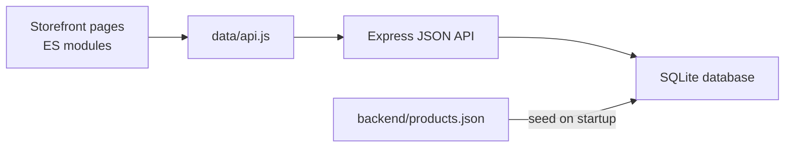

<div align="center">

# Amazon Storefront

### A full-stack storefront built as a JavaScript learning project

Browse a product catalog, manage a cart, place demo orders, and follow their delivery status.


</div>

---

## At a glance

This project takes a static storefront and gives it a small API and persistent database. The browser handles the interface; an Express server owns cart state, order history, and checkout calculations; SQLite keeps the data between restarts.

> **Learning demo:** Orders are simulated. There are no customer accounts, inventory reservations, or real payments.

## What you can do

- Browse and search products from the catalog.
- Add products to a session-specific cart and adjust quantities.
- Choose a delivery speed and see server-calculated shipping, tax, and totals.
- Place demo orders and view order history.
- Add a past purchase to the cart again and open its tracking view.
- Keep cart and order data after a page reload or server restart.

## How it fits together



The API assigns each browser an anonymous session cookie. It is a demo session identifier, not an account or authentication system. Product prices and checkout totals are read or calculated on the server rather than trusted from the page.

## Run locally

### Requirements

- Node.js 20 or newer
- npm

### Start the storefront

Open a terminal in the project directory:

```powershell
cd "C:\Users\rt855\Desktop\javascript-learning-journey\javascript-amazon-project"
npm install
npm start
```

Open **http://localhost:3001/amazon.html**. Keep the terminal open while using the app.

The project has its own `package.json` and dependencies. Run these commands from `javascript-amazon-project`, not the parent `javascript-learning-journey` folder. Port `3001` is the default; to use a different port in PowerShell:

```powershell
$env:PORT=3002
npm start
```

For automatic server restarts during development:

```powershell
npm run dev
```

## API overview

All API responses use JSON. Errors have the shape `{ "error": { "message": "..." } }`.

| Method | Endpoint | Purpose |
| --- | --- | --- |
| `GET` | `/api/products` | Read the product catalog |
| `GET` | `/api/delivery-options` | Read available shipping choices |
| `GET` | `/api/cart` | Read the current session’s cart and totals |
| `POST` | `/api/cart/items` | Add a product (`productId`, `quantity`) |
| `PATCH` | `/api/cart/items/:productId` | Set a cart item quantity |
| `PATCH` | `/api/cart/items/:productId/delivery` | Set a cart item’s delivery option |
| `DELETE` | `/api/cart/items/:productId` | Remove a cart item |
| `POST` | `/api/orders` | Place an order from the current cart |
| `GET` | `/api/orders` | List orders for the current session |
| `GET` | `/api/orders/:orderId` | Read an order for tracking |

Cart writes validate product IDs, quantities, and delivery options. The server calculates the order total using the demo’s 10% tax convention and selected shipping costs.

## Data and tests

- `backend/products.json` is loaded into SQLite when the server starts.
- The default database is `data/store.sqlite`; it is local and ignored by Git.
- Cart and order records are associated with the anonymous session cookie.
- Run the automated backend tests with:

```powershell
npm test
```

The tests cover the catalog, session isolation, request validation, server-side totals, order privacy, and persistence after restarting the server.

## Project map

```text
backend/
  app.js              Express routes and request handling
  database.js         SQLite schema and product seeding
  products.json       Product catalog source
  server.js           Local server entry point
data/
  api.js              Browser API helper
  cart.js             Cart API functions
  orders.js           Order API functions
scripts/
  amazon.js           Catalog, search, and add-to-cart UI
  checkout.js         Cart editing and checkout UI
  orders.js           Order history and Buy Again UI
  tracking.js         Order tracking UI
tests/
  backend.test.js     API and persistence tests
```

## Scope and next steps

This app is intended for local learning and demonstration, not production commerce. It does not provide sign-in, real payments, inventory management, or production deployment configuration. Those would need deliberate design and security work before the app could handle real customers or payment data.
